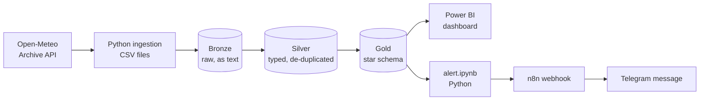
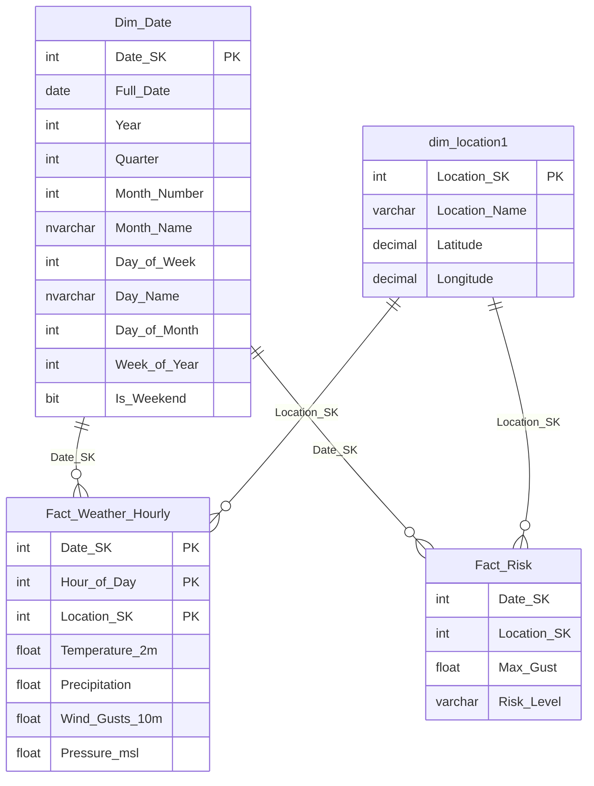
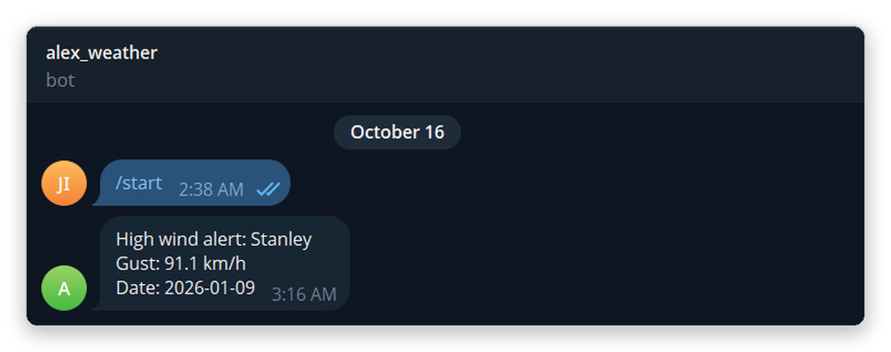

<h1 align="center">Alexandria Weather Risk Platform</h1>

<p align="center">
  <b>An end-to-end data engineering pipeline for coastal wind risk in Alexandria, Egypt</b><br>
  Open-Meteo &rarr; SQL Server medallion warehouse &rarr; Power BI dashboard &rarr; n8n + Telegram alerts
</p>

<p align="center">
  
  
  
  
  
  
  
</p>

## Highlights

- **API to warehouse:** hourly weather for 3 coastal points (Stanley, Borg El Arab, Abu Qir) pulled from Open-Meteo with Python
- **Medallion architecture:** Bronze (raw) &rarr; Silver (typed, de-duplicated) &rarr; Gold (star schema) in SQL Server
- **Dimensional model:** date and location dimensions, an hourly fact table and a daily risk fact table
- **Risk scoring:** every location-day is flagged High or Low from its maximum wind gust
- **Power BI dashboard:** slicer, KPI cards, rainfall chart, risk map and a daily wind-gust trend
- **Telegram alert:** the highest-risk day is pushed through an n8n webhook (n8n runs in Docker)

## Results at a glance

| | |
|---|---|
| Hourly rows loaded | **6,480** (3 locations x 90 days x 24 h) |
| Location-days scored | **270** |
| Risk split | **18 High** / **252 Low** |
| Peak gust | **91.1 km/h**, Stanley, 2026-01-09 |
| Warehouse | 3 layers, star schema with 2 dimensions and 2 fact tables |

## What this project demonstrates

| Skill | Where |
|-------|-------|
| REST API ingestion with Python (`requests`, `pandas`) | `notebooks/00_ingestion.ipynb` |
| Medallion architecture (Bronze / Silver / Gold) | `notebooks/01-03`, `sql/` |
| Dimensional modelling: star schema, date dimension built by a stored procedure, composite primary key | `sql/01_setup_warehouse.sql` |
| Data cleaning: type casting, null check, de-duplication on `(location, time)` | `notebooks/02_silver.ipynb` |
| BI: Import-mode model, one-to-many relationships, map / line / column visuals | `dashboard/Alex_Weather_Risk.pbix` |
| Integration: webhook, Telegram bot, Docker, ngrok | `notebooks/04_alert.ipynb` + n8n |
| Debugging: idempotency, primary-key violations, connection errors | [Challenges solved](#challenges-solved) |

## Table of contents

1. [Architecture](#architecture)
2. [Tech stack](#tech-stack)
3. [Data source](#data-source)
4. [Data model](#data-model)
5. [Risk logic](#risk-logic)
6. [Dashboard](#dashboard)
7. [Alerting](#alerting)
8. [Challenges solved](#challenges-solved)
9. [Repository structure](#repository-structure)
10. [How to run](#how-to-run)
11. [Roadmap](#roadmap)

---

## Architecture



The layers live in one SQL Server database (`Alex_weather`) as three schemas: `bronze`, `silver`, `gold`.

| Layer | What happens |
|-------|--------------|
| **Bronze** | CSV is loaded as-is. Every column is stored as text. |
| **Silver** | Types are cast (`datetime`, `float`), nulls are checked, duplicates on `(location, time)` are removed. |
| **Gold** | Star schema: date and location dimensions, an hourly fact table, and a daily risk fact table. |

## Tech stack

- **Python** (Jupyter notebooks in VS Code): ingestion, Bronze/Silver loads, running the Gold SQL, sending the alert
- **SQL Server** with **SQLAlchemy** + **pyodbc**
- **Power BI Desktop**: dashboard (Import mode)
- **n8n** (self-hosted in **Docker**, exposed with **ngrok**): webhook + Telegram node
- **Open-Meteo API**: free, no API key

## Data source

- Endpoint: `https://archive-api.open-meteo.com/v1/archive` (historical data)
- Hourly variables: `temperature_2m`, `precipitation`, `wind_gusts_10m`, `pressure_msl`
- Timezone: `Africa/Cairo`
- Period: **2026-01-01 to 2026-03-31** (90 days x 24 h x 3 locations = **6,480 rows**)

| Location | Latitude | Longitude |
|----------|----------|-----------|
| Stanley | 31.24 | 29.95 |
| Borg_El_Arab | 30.85 | 29.60 |
| Abu_Qir | 31.32 | 30.07 |

Coordinates are approximate (taken from Google Maps). Wind gusts are in **km/h**, the Open-Meteo default.

## Data model



| Table | Grain | Rows |
|-------|-------|------|
| `gold.Dim_Date` | one row per day, 2025-01-01 to 2030-12-31 (filled by a stored procedure) | 2,191 |
| `gold.dim_location1` | one row per location | 3 |
| `gold.Fact_Weather_Hourly` | location x date x hour (PK on those three columns) | 6,480 |
| `gold.Fact_Risk` | location x date (`GROUP BY` + `CASE WHEN`) | 270 |

## Risk logic

```sql
CASE WHEN MAX(Wind_Gusts_10m) >= 65 THEN 'High' ELSE 'Low' END AS Risk_Level
```

A location-day is **High** when its daily maximum wind gust is **>= 65 km/h**, otherwise **Low**. The 65 km/h threshold is a project-defined rule, not an official standard.

| Location | Max gust (km/h) | High days | Days |
|----------|-----------------|-----------|------|
| Stanley | 91.1 (2026-01-09) | 9 | 90 |
| Abu_Qir | 77.8 | 6 | 90 |
| Borg_El_Arab | 67.7 | 3 | 90 |
| **Total** | | **18 High / 252 Low** | 270 |

Stanley is the windiest point: it has the strongest gust and the most High days.

## Dashboard

The Power BI report is in [`dashboard/Alex_Weather_Risk.pbix`](alex-weather-risk-platform/alex-weather-risk-platform/dashboard/Alex_Weather_Risk.pbix). It is a single page in Import mode, connected to the Gold layer.

<p align="center">
  
</p>

| Visual | What it shows |
|--------|---------------|
| Location slicer | Filters the whole page by location |
| Cards | Max wind gust, average temperature, High-risk days, Low-risk days |
| Monthly rainfall | Column chart of rainfall per month |
| Risk map | The locations on a map, coloured by risk level |
| Daily max wind gust | Line chart of the daily maximum gust, per location |

*The screenshot is filtered to Borg_El_Arab: max gust 67.7 km/h, average temperature 15.34 °C, 3 High days and 87 Low days.*

The four Gold tables are related one-to-many on `Date_SK` and `Location_SK`.

## Alerting

An n8n workflow (running in Docker) with two nodes: a **Webhook** (POST) that triggers a Telegram **Send a text message** node.

<p align="center">
  
</p>

`notebooks/04_alert.ipynb` queries `gold.Fact_Risk` for the High-risk day with the highest `Max_Gust` and POSTs `location`, `date` and `max_gust` to the webhook, which sends this Telegram message:

<p align="center">
  
</p>

The webhook URL is read from the `N8N_WEBHOOK_URL` environment variable and is not stored in the notebooks. The workflow and the Telegram bot credentials live in the n8n instance, not in this repo. The demo runs on the Jan-Mar 2026 data, so the message reports 2026-01-09.

## Challenges solved

| Problem | Fix |
|---------|-----|
| Duplicate rows after re-running notebooks (Silver once had 32,400 rows instead of 6,480) | `TRUNCATE` before reloading and run load cells exactly once; `to_sql` append is not idempotent |
| Primary key violation in Gold | Caused by the duplicated Silver data; fixed by cleaning Silver first |
| Power BI encrypted-connection error | Disabled "Use encrypted connection" (local server) |
| `SELECT INTO` fails if the table already exists | `DROP TABLE IF EXISTS gold.Fact_Risk` before rebuilding |
| n8n test webhook only works once per "Listen" click | Switched to the **Production** URL and published the workflow |

## Repository structure

```
.
├── README.md
├── requirements.txt
├── .env.example               # template for the n8n webhook URL
├── notebooks/
│   ├── 00_ingestion.ipynb     # Open-Meteo -> CSV per location -> weather_all.csv
│   ├── 01_bronze.ipynb        # CSV -> bronze.weather
│   ├── 02_silver.ipynb        # bronze -> silver.weather (types, de-dup)
│   ├── 03_gold.ipynb          # silver -> Gold fact tables
│   └── 04_alert.ipynb         # top High-risk day -> n8n webhook
├── sql/
│   └── 01_setup_warehouse.sql # database, schemas, tables, dimensions
├── data/                      # per-location CSVs + merged weather_all.csv (6,480 rows)
├── dashboard/
│   └── Alex_Weather_Risk.pbix # Power BI report (Import mode)
└── docs/images/               # screenshots used in this README
```

## How to run

**Prerequisites:** SQL Server (local), ODBC Driver 17 for SQL Server, Python 3.10+. The notebooks use Windows authentication (`trusted_connection=yes`) against `localhost`; edit the connection string at the top of each notebook if your setup differs.

**1. Create the warehouse.** Run `sql/01_setup_warehouse.sql` once in SSMS. It creates the `Alex_weather` database, the three schemas, all tables, and fills `Dim_Date` and `dim_location1`.

**2. Install the packages.**

```bash
python -m venv .venv
.venv\Scripts\activate          # Windows
pip install -r requirements.txt
```

**3. Run the notebooks in order** (open them from the `notebooks/` folder, the CSV paths are relative to it):

| Order | Notebook | Result |
|-------|----------|--------|
| 1 | `00_ingestion.ipynb` | `data/weather_all.csv` (6,480 rows) |
| 2 | `01_bronze.ipynb` | `bronze.weather` loaded |
| 3 | `02_silver.ipynb` | `silver.weather` loaded |
| 4 | `03_gold.ipynb` | `gold.Fact_Weather_Hourly` (6,480) and `gold.Fact_Risk` (270) |

> **Tip:** run the Bronze and Silver load cells once. They use `to_sql(..., if_exists='append')`, so running them twice duplicates the rows. To reload from scratch, run `TRUNCATE TABLE bronze.weather;` and `TRUNCATE TABLE silver.weather;` first. `03_gold` is safe to re-run.

**4. Open the dashboard.** Open `dashboard/Alex_Weather_Risk.pbix` in Power BI Desktop. It opens with the data saved inside it. To refresh it from your own database, point it at SQL Server `localhost` / `Alex_weather`. If you get an encrypted-connection error on a local server, untick **Use encrypted connection**.

**5. (Optional) Telegram alert.**
1. Run n8n in Docker, expose it with ngrok, create the workflow described in [Alerting](#alerting) and publish it.
2. Copy `.env.example` to `.env` and put your **Production** webhook URL in `N8N_WEBHOOK_URL`. Keep `.env` out of your commits, because the URL lets anyone trigger your bot.
3. Run `notebooks/04_alert.ipynb`.

## Roadmap

- Data quality checks after each load (freshness, completeness, row-count volume) with an audit table, plus a `silver.rejected_weather` table for invalid rows
- Idempotent Silver load, then scheduled runs of the notebooks (for example Windows Task Scheduler running `jupyter nbconvert --execute`)
- Forecast endpoint ingestion so the alert reflects upcoming weather
- Medium / Severe levels and rain-based rules, with thresholds backed by an official source
- Egypt-specific `Is_Weekend` (Friday/Saturday) in `Dim_Date`
- Dashboard polish: card titles, a reference line at 65 km/h on the wind chart, chronological month order, a page title
