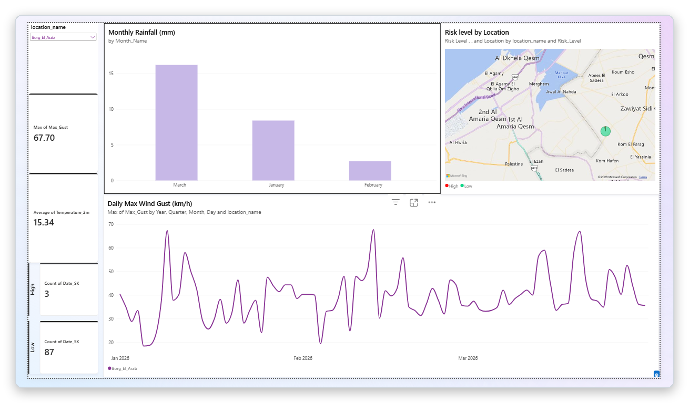
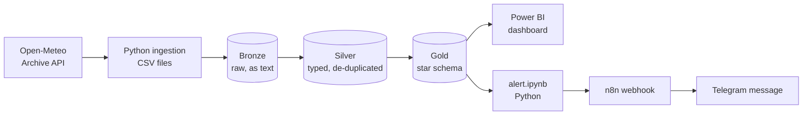
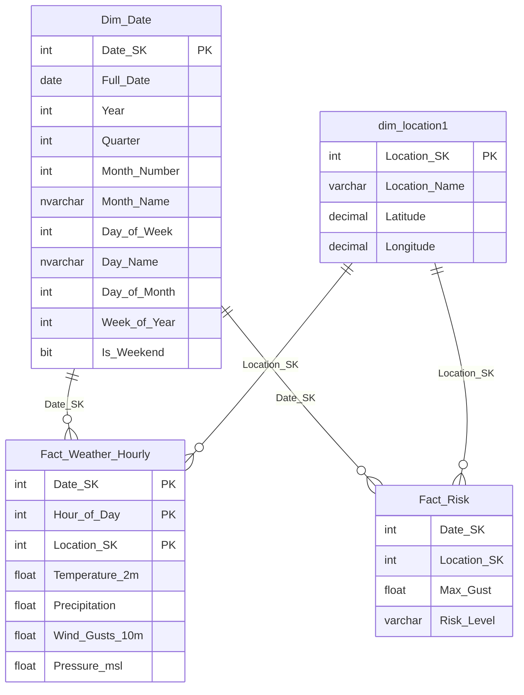
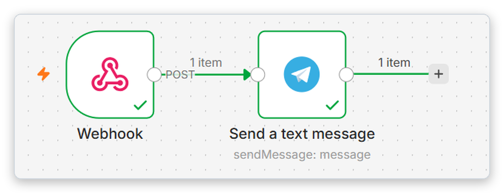

<h1 align="center">Alexandria Weather Risk Platform</h1>

<p align="center">
  Hourly weather for three coastal points in Alexandria, Egypt, modelled in a Bronze / Silver / Gold warehouse on SQL Server,<br>
  flagged for high-wind days, shown in Power BI, and pushed to Telegram through n8n.
</p>

<p align="center">
  
  
  
  
  
  
</p>

<p align="center">
  
</p>

> Built as a portfolio project for the **DEPI Microsoft Data Engineer** track.
> Please read [Limitations](#limitations): the risk threshold, coordinates and wind unit are estimates, and the pipeline is run manually (no scheduling yet).

## Results at a glance

| | |
|---|---|
| Hourly rows loaded | **6,480** (3 locations x 90 days x 24 h) |
| Location-days scored | **270** |
| Risk split | **18 High** / **252 Low** |
| Peak gust | **91.1 km/h**, Stanley, 2026-01-09 |
| Warehouse | 3 layers, star schema with 2 dimensions and 2 fact tables |

## Table of contents

1. [Architecture](#architecture)
2. [Tech stack](#tech-stack)
3. [Data source](#data-source)
4. [Data model](#data-model)
5. [Risk logic](#risk-logic)
6. [Repository structure](#repository-structure)
7. [How to run](#how-to-run)
8. [Dashboard](#dashboard)
9. [Alerting](#alerting)
10. [Challenges solved](#challenges-solved)
11. [Limitations](#limitations)
12. [Future improvements](#future-improvements)

---

## Architecture



The layers live in one SQL Server database (`Alex_weather`) as three schemas: `bronze`, `silver`, `gold`.

| Layer | What happens |
|-------|--------------|
| **Bronze** | CSV is loaded as-is. Every column is stored as text. |
| **Silver** | Types are cast (`datetime`, `float`), nulls are checked, duplicates on `(location, time)` are removed. |
| **Gold** | Star schema: date and location dimensions, an hourly fact table, and a daily risk fact table. |

## Tech stack

- **Python** (Jupyter notebooks in VS Code): ingestion, Bronze/Silver loads, running the Gold SQL, sending the alert
- **SQL Server** with **SQLAlchemy** + **pyodbc**
- **Power BI Desktop**: dashboard (Import mode)
- **n8n** (self-hosted, exposed with **ngrok**): webhook + Telegram node
- **Open-Meteo API**: free, no API key

## Data source

- Endpoint used by the ingestion notebook: `https://archive-api.open-meteo.com/v1/archive` (historical backfill)
- Hourly variables: `temperature_2m`, `precipitation`, `wind_gusts_10m`, `pressure_msl`
- Timezone: `Africa/Cairo`
- Backfill window: **2026-01-01 to 2026-03-31** (90 days x 24 h x 3 locations = **6,480 rows**)

| Location | Latitude | Longitude |
|----------|----------|-----------|
| Stanley | 31.24 | 29.95 |
| Borg_El_Arab | 30.85 | 29.60 |
| Abu_Qir | 31.32 | 30.07 |

Coordinates are approximate (taken from Google Maps). Wind gusts are assumed to be in **km/h**, which is the Open-Meteo default (no unit override is passed in the requests).

## Data model



| Table | Grain | Rows |
|-------|-------|------|
| `gold.Dim_Date` | one row per day, 2025-01-01 to 2030-12-31 (filled by a stored procedure) | 2,191 |
| `gold.dim_location1` | one row per location | 3 |
| `gold.Fact_Weather_Hourly` | location x date x hour (PK on those three columns) | 6,480 |
| `gold.Fact_Risk` | location x date (`GROUP BY` + `CASE WHEN`) | 270 |

## Risk logic

```sql
CASE WHEN MAX(Wind_Gusts_10m) >= 65 THEN 'High' ELSE 'Low' END AS Risk_Level
```

A location-day is **High** when its daily maximum wind gust is **>= 65 km/h**, otherwise **Low**.

> **The 65 threshold is my own estimate, not an official standard.** Rain-based rules and Medium/Severe levels were deliberately left out to keep the first version simple.

Result on the backfill data (270 location-days):

| Location | Max gust (km/h) | High days | Days |
|----------|-----------------|-----------|------|
| Stanley | 91.1 (2026-01-09) | 9 | 90 |
| Abu_Qir | 77.8 | 6 | 90 |
| Borg_El_Arab | 67.7 | 3 | 90 |
| **Total** | | **18 High / 252 Low** | 270 |

## Repository structure

```
.
├── README.md
├── requirements.txt
├── .env.example               # template for the n8n webhook URL
├── notebooks/
│   ├── 00_ingestion.ipynb     # Open-Meteo -> CSV per location -> weather_all.csv
│   ├── 01_bronze.ipynb        # CSV -> bronze.weather
│   ├── 02_silver.ipynb        # bronze -> silver.weather (types, de-dup)
│   ├── 03_gold.ipynb          # silver -> Gold fact tables
│   └── 04_alert.ipynb         # top High-risk day -> n8n webhook
├── sql/
│   └── 01_setup_warehouse.sql # database, schemas, tables, dimensions
├── data/                      # per-location CSVs + merged weather_all.csv (6,480 rows)
├── dashboard/
│   └── Alex_Weather_Risk.pbix # Power BI report (Import mode)
└── docs/images/               # screenshots used in this README
```

## How to run

### Prerequisites

- SQL Server (local instance) and **ODBC Driver 17 for SQL Server**
- Python 3.10+
- The notebooks connect with **Windows authentication** (`trusted_connection=yes`) to `localhost`, so they are written for a Windows machine with a local SQL Server. Edit the connection string at the top of each notebook if your setup differs.

### 1. Create the warehouse

Run `sql/01_setup_warehouse.sql` in SSMS (or Azure Data Studio) **once** on a fresh server. It creates the `Alex_weather` database, the three schemas, all tables, and fills `Dim_Date` and `dim_location1`.

### 2. Install Python packages

```bash
python -m venv .venv
.venv\Scripts\activate          # Windows
pip install -r requirements.txt
```

### 3. Run the notebooks in order

Open the notebooks from the `notebooks/` folder (the CSV paths are relative to it) and run every cell, top to bottom:

| Order | Notebook | Result |
|-------|----------|--------|
| 1 | `00_ingestion.ipynb` | `data/weather_all.csv` (6,480 rows) |
| 2 | `01_bronze.ipynb` | `bronze.weather` loaded |
| 3 | `02_silver.ipynb` | `silver.weather` loaded |
| 4 | `03_gold.ipynb` | `gold.Fact_Weather_Hourly` (6,480) and `gold.Fact_Risk` (270) |

> **Run the load cells once.** `01_bronze` and `02_silver` use `to_sql(..., if_exists='append')`, which is **not idempotent**: running them twice duplicates the rows (and then breaks the Gold primary key). To reload from scratch, first run:
> ```sql
> TRUNCATE TABLE bronze.weather;
> TRUNCATE TABLE silver.weather;
> ```
> `03_gold` is safe to re-run: it truncates the hourly fact and rebuilds `Fact_Risk` each time.

### 4. Open the dashboard

Open `dashboard/Alex_Weather_Risk.pbix` in Power BI Desktop. It is in Import mode, so it opens with the data already saved inside it. To refresh it against your own database, point it at SQL Server `localhost` / database `Alex_weather`. If you get an encrypted-connection error on a local server, untick **Use encrypted connection**. The four Gold tables are related one-to-many on `Date_SK` and `Location_SK`.

### 5. (Optional) Set up the alert

1. Create the n8n workflow described in [Alerting](#alerting) and publish it.
2. Copy `.env.example` to `.env` and put your **Production** webhook URL in `N8N_WEBHOOK_URL`. Keep `.env` out of your commits: the URL lets anyone trigger your Telegram bot.
3. Run `04_alert.ipynb`.

## Dashboard

One Power BI page connected to the Gold layer:

- Location dropdown slicer
- Cards: max wind gust, average temperature, High-risk days, Low-risk days
- Monthly rainfall column chart
- Map of the locations, coloured by risk level
- Daily max wind gust line chart, per location

<p align="center">
  
</p>

*Screenshot filtered to Borg_El_Arab: max gust 67.7 km/h, average temperature 15.34 °C, 3 High days and 87 Low days.*

## Alerting

An n8n workflow with two nodes: a **Webhook** (POST) that triggers a Telegram **Send a text message** node.

<p align="center">
  
</p>

`04_alert.ipynb` queries `gold.Fact_Risk` for the High-risk day with the highest `Max_Gust` and POSTs `location`, `date` and `max_gust` to the webhook, which produces this Telegram message:

<p align="center">
  
</p>

The webhook URL is read from the `N8N_WEBHOOK_URL` environment variable and is **not** stored in the notebooks. The n8n workflow and the Telegram bot credentials live in the n8n instance and are not part of this repo.

> Today the alert runs on the **historical backfill data**, so it reports a past day (2026-01-09), not a live forecast.

## Challenges solved

| Problem | Fix |
|---------|-----|
| Duplicate rows after re-running notebooks (Silver once had 32,400 rows instead of 6,480) | `TRUNCATE` before reloading and run load cells exactly once; `to_sql` append is not idempotent |
| Primary key violation in Gold | Caused by the duplicated Silver data; fixed by cleaning Silver first |
| Power BI encrypted-connection error | Disabled "Use encrypted connection" (local server) |
| `SELECT INTO` fails if the table already exists | `DROP TABLE IF EXISTS gold.Fact_Risk` before rebuilding |
| n8n test webhook only works once per "Listen" click | Switched to the **Production** URL and published the workflow |

## Limitations

- **The High-risk threshold (>= 65 km/h) is an estimate**, not an official standard. Only two levels exist (High / Low).
- **Coordinates are approximate** and the **wind unit is assumed to be km/h** (the Open-Meteo default).
- **The alert is historical.** It reads the Jan-Mar 2026 backfill, so it reports a past day.
- **No scheduling.** Every notebook is run by hand; nothing refreshes the data automatically.
- **Ingestion currently uses only the archive (historical) endpoint**, not the forecast endpoint.
- **No data quality checks yet** and no rejected-rows table: the only cleaning is type casting, a null check and de-duplication in Silver.
- **Reloads are manual and not idempotent** (see [How to run](#3-run-the-notebooks-in-order)).
- `Is_Weekend` in `Dim_Date` marks Sunday/Saturday; Egypt's weekend is Friday/Saturday.
- Dashboard polish is pending (card titles, a reference line at 65 on the wind chart, chronological month order, a page title).
- The notebooks use Windows authentication and `localhost`, and the ngrok free URL can change between sessions.

## Future improvements

- Data quality checks after each load (freshness, completeness/nulls, row-count volume) with results written to an audit table
- `silver.rejected_weather` table for invalid rows
- Make Silver idempotent (truncate before load) and then schedule the notebooks in order (for example Windows Task Scheduler running `jupyter nbconvert --execute`)
- Switch ingestion to the forecast endpoint so the alert reflects upcoming weather
- Add Medium/Severe levels and rain-based rules, with thresholds backed by an official source
- Fix `Is_Weekend` for Egypt (Friday/Saturday) and remove the unused empty `gold.dim_location` table
- Polish the dashboard
